# GEN-Z Music

**Project JSLW "GEN-Z" Music Player** · by Partho Ghosh · © 2026 JSL WORKS PVT LTD

A fully offline music player for Android, built for music lovers who want a player that looks and
feels like their music. It runs on **Android 4.4 KitKat through Android 16**, on phones and tablets,
with no internet permission at all.

> Package `com.jslw.genz` · Version 1.8 · 🇮🇳 Made in India with ♥

**⬇️ [Download the latest APK and user guide](https://github.com/founderjslworks/jslw-genz-music-player/releases/latest)** · 🌐 [www.jslworks.in](https://www.jslworks.in/android-devlopment)

🖥️ **On a PC?** GEN-Z Music for Windows (Windows 7 to 11) has its own home: [founderjslworks/jslw-genz-music-windows](https://github.com/founderjslworks/jslw-genz-music-windows).

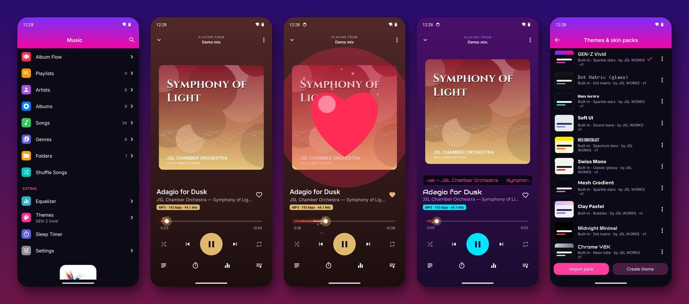


## What's new in 1.8

- **Android Auto**: GEN-Z appears on your car's screen with its own icon. Browse Recently played, Favourites, Playlists, Albums (as cover grid), Artists, Genres and All songs, tap to play, see Up next, use the heart and shuffle buttons, and ask the Assistant: *"Play Arijit Singh on GEN-Z Music"*.
- Every new APK now installs over the previous one – no uninstall needed (from 1.8 on).

> **Android Auto with the APK from GitHub:** Android Auto only lists Play Store apps until you allow others once.
> On the phone open **Android Auto settings**, tap **Version** 10 times to unlock developer mode, then **⋮ › Developer settings › Unknown sources** ✓, and reconnect to the car.

## What's new in 1.7
- **Turntable widgets**: pearl turntable design with your cover as the record label, a tonearm, round 3D buttons and a live duration (4×1, 4×2 and 2×2)
- **Spinning vinyl** cover mode with a tonearm that lifts on pause
- **Hardware-style controls**: click wheel, recorder keypad, radio seek knob, tuning dial and analog needle gauge
- **8 new themes**: Wheel Noir, Cream Wheel, Pocket Recorder, Turntable Rose, Retro Deck, Radio Deck, Tuner Orange, Analog Dial
- Animated play / pause / next, equalizer iconography, new app icon, website links and Share in About
- 🇮🇳 *Made in India with ♥* – with a beating heart – on every screen

---

## Highlights

**Sound**
- Gapless playback, crossfade, fade in and out, speed and pitch control
- 10-band graphic equalizer (Android 9+) with presets, bass boost, 3D surround, loudness and reverb
- Clean output: automatic headroom so EQ boosts never clip, a safety limiter, ReplayGain, TPDF dither
- Hi-res: native-rate 32-bit float output, format badge (e.g. *FLAC · 24-bit · 96 kHz · HI-RES*),
  bit-perfect USB DAC mode on Android 14+
- Plays MP3, AAC/M4A, FLAC, WAV, OGG, Opus, MIDI and ALAC, plus **AIFF and DSD (DSF/DFF)** through
  GEN-Z's own decoder

**Look and feel**
- **42 built-in themes**: turntable, click wheel, radio deck, tuner, analog dial, devotional, Bollywood, lo-fi, EDM neon, synthwave, hip-hop, rock, jazz,
  classical, K-pop, glass, dot-matrix, soft UI, neo-brutalist and more
- Every theme has its own Google Fonts, its own animated progress bar (sparkle, neon, wave, spectrum,
  8-bit, fire, bubbles, petals, hearts, notes, snow, tape, classic, dot matrix) and its own cover effect
- **Skin packs**: import, update and export `.zip` packs with your own colours, fonts, icons and
  background, or design one on the phone in the Theme Editor (see [THEMES.md](THEMES.md))
- **Cover touch effects**: 33 effects play when you touch the album art, from water ripple and lens
  flare to blinds, dewdrop, pixelate and the four seasons
- Album Flow: a 3D album carousel with reflections and a slide-to-unlock style scrubber
- Progress bars take their colours from each song's cover
- Bouncy menus, list scroll animations and screen transitions; smooth on 60–144 Hz screens
- A joyful heart-and-confetti celebration when you favourite a song

**Library and tools**
- Browse by artist, album, genre, folder and playlist; queue with drag to reorder; instant search
- Synced and embedded lyrics, plus floating lyrics over other apps
- Tag and cover editor, ringtone maker, sleep timer, shake to skip
- Lock-screen controls, an optional full-screen lock-screen player with a charging doodle
- Home-screen widgets in three sizes, coloured by the active theme

**Privacy**
- No internet permission, no ads, no analytics, no accounts. Nothing leaves the phone.
  See [docs/privacy-policy.html](docs/privacy-policy.html).

---

## Screenshots

| Home | Now Playing | Albums | Equalizer |
|:-:|:-:|:-:|:-:|
| 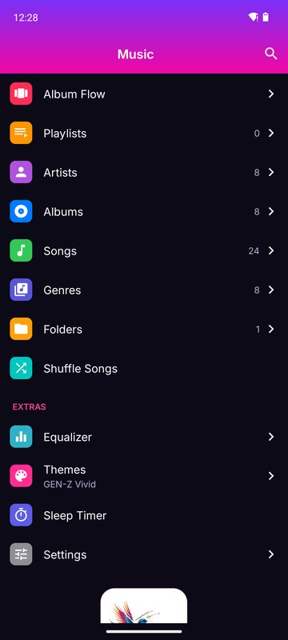 | 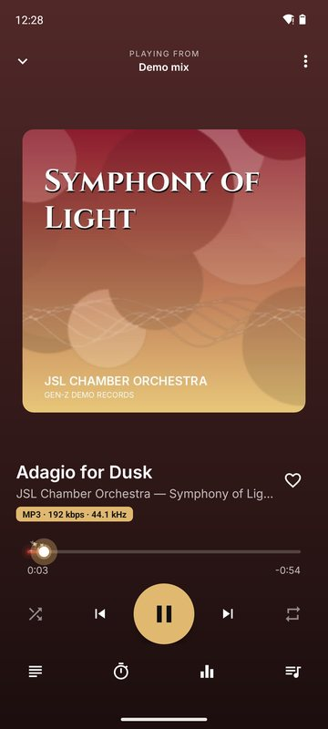 | 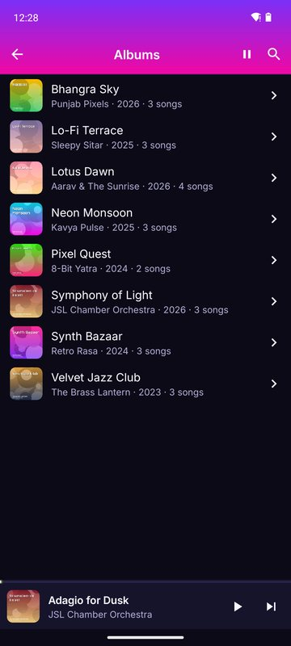 | 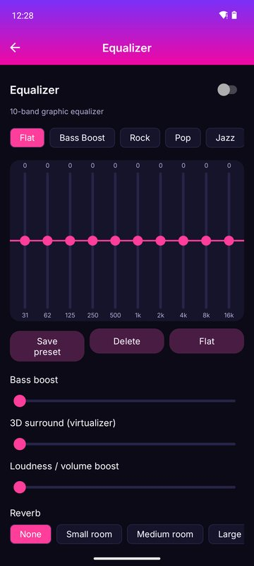 |
| **Themes** | **Theme editor** | **Love it!** | **Lock screen** |
| 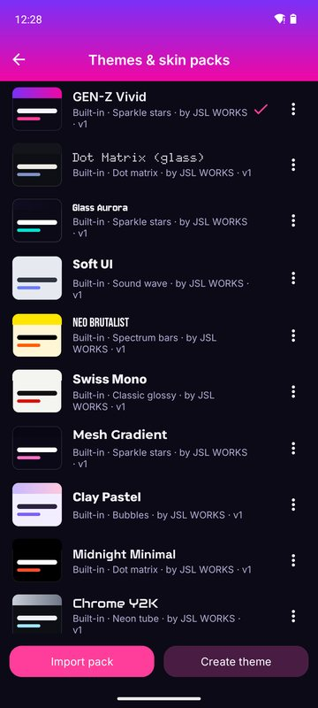 | 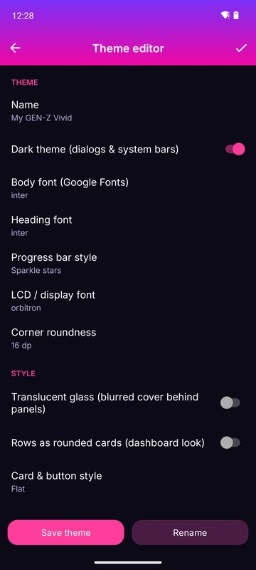 | 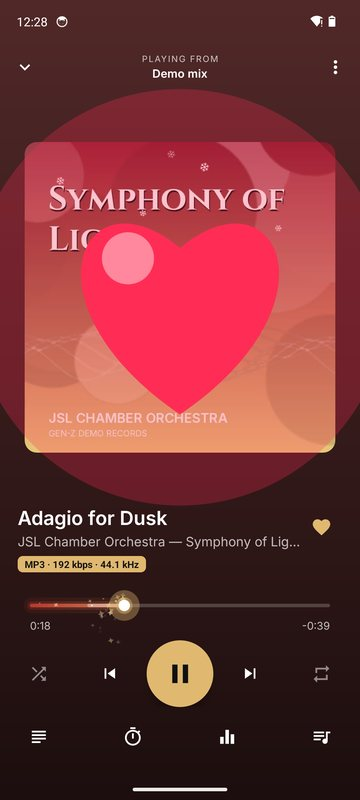 | 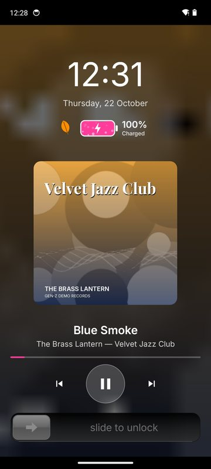 |
| **Bollywood Nights** | **Synthwave '84** | **Retro Clickwheel** | **Cassette '84** |
| 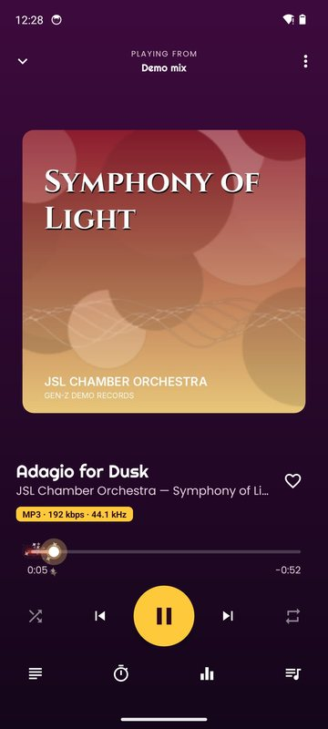 | 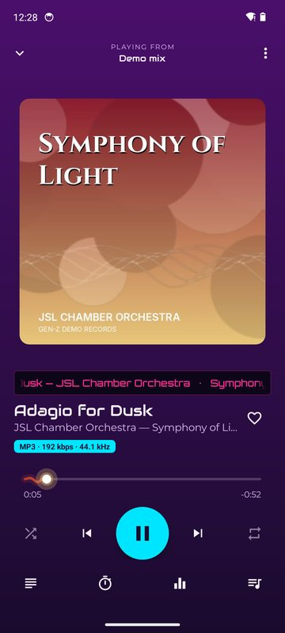 | 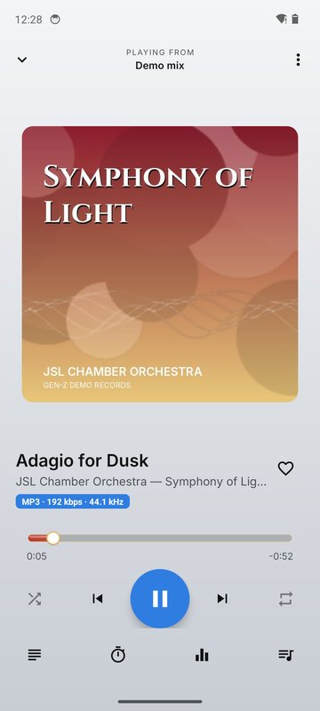 | 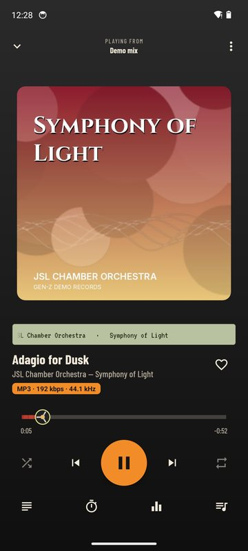 |

<sub>Screenshots use original demo songs and covers made for the user guide.</sub>

## Download

Every push to `main` is built automatically. The latest debug APK and the release bundle are on the
[`ci-output`](../../tree/ci-output) branch.

## Build it yourself

1. Install **Android Studio** (Ladybug or newer) with Android SDK 36.
2. Open this folder and let Gradle sync.
3. Press **Run**, or use *Build → Build APK(s)*.

Release bundle for Google Play: `./gradlew bundleRelease`, signed with your upload key through the
`GENZ_KEYSTORE`, `GENZ_KEYSTORE_PASSWORD`, `GENZ_KEY_ALIAS` and `GENZ_KEY_PASSWORD` environment
variables (or the matching GitHub secrets).

> Don't accept Android Studio's offers to upgrade the AndroidX / Material libraries in
> `app/build.gradle.kts`. They are pinned to the last versions that still support Android 4.4.

## Project layout

```
app/src/main/java/com/jslw/genz/
  audio/     playback engines (system decoder + own PCM/DSD decoder), effects, formats, tags
  data/      music scanner, library, playlists and statistics, settings
  playback/  background playback service, lyrics, shake to skip, floating lyrics
  skin/      themes and skin packs, fonts, icon packs
  ui/        all screens; ui/views holds the custom views (progress bars, cover effects, sliders …)
  widget/    home-screen widgets
app/src/main/assets/skins/   built-in themes (JSON)
app/src/main/res/font/       bundled Google Fonts
```

## Licence

**All rights reserved.** This code is public so it can be viewed. It is not open source. See
[LICENSE](LICENSE). Third-party components keep their own licences (Apache 2.0, SIL OFL 1.1); see
`app/src/main/assets/licenses/`.
