# GEN-Z Music

[](https://doi.org/10.5281/zenodo.23637904)

**Official Zenodo DOI:** [10.5281/zenodo.23637904](https://doi.org/10.5281/zenodo.23637904)  
**Developer:** Partho Ghosh  
**Organization:** JSL WORKS PVT LTD  
**ORCID:** [0009-0000-0061-2451](https://orcid.org/0009-0000-0061-2451)

**Project JSLW "GEN-Z" Music Player** · by Partho Ghosh · © 2026 JSL WORKS PVT LTD

A fully offline music player for Android, built for music lovers who want a player that looks and
feels like their music. It runs on **Android 4.4 KitKat through Android 16**, on phones and tablets,
with no internet permission at all.

> Package `com.jslw.genz` · Version 1.9 · 🇮🇳 Made in India with ♥

**⬇️ [Download the latest APK and user guide](https://github.com/founderjslworks/jslw-genz-music-player/releases/latest)** · 🌐 [www.jslworks.in](https://www.jslworks.in/android-devlopment)

🖥️ **On a PC?** GEN-Z Music for Windows (Windows 7 to 11) has its own home: [founderjslworks/jslw-genz-music-windows](https://github.com/founderjslworks/jslw-genz-music-windows).

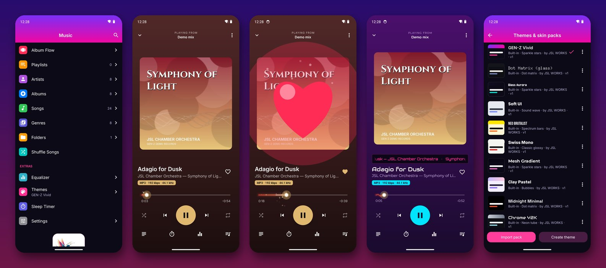


## What's new in 1.9.17

- **Auto for Room, Modes and Equalizer** – each follows the song *while it plays*: Audio+ now listens in short sections (every ~6 s) all the way through, not only the first 15 seconds
  - **Room · Auto**: starts on the preset's room, goes one size bigger for quiet, open passages and smaller and drier for busy, loud or fast ones; changes only when two sections agree, so it never flickers. The tile shows the room in use ("Now: Medium Hall")
  - **Modes · Auto**: Sound Stage for narrow mixes, Sound Separation when there's a voice to lift, Instrument Separation for dense, compressed mixes – eased in and out smoothly; each mode shows its live level
  - **Equalizer · Auto** (with Audio+): a gentle correction (±4.5 dB) toward the average tonal balance of *your* music, learned as you listen – dull songs get air, boomy songs get tamed. The sliders and curve move live; dragging a slider takes over manually
- **A picture for every room**: Small / Medium / Large Room, halls with columns, Party Hall with a disco ball, Concert Hall with stage and seats, Plate, Temple (shikhara), Cathedral (gothic arch) – with a line showing how long each one echoes
- Auto choices are remembered per device, like the rest of Audio+
- **Soundbar** joins Headphones, Speaker and Car: moderate bass, a wider stage that opens the music beyond the bar, and clearer voices. TVs / HDMI / ARC outputs and devices named like a soundbar are set to Soundbar automatically
- **Icons** for every output type, and the current output (phone speaker, headphones, speaker, soundbar or car) is shown with its icon

## What's new in 1.9.16

- **Fixed: the equalizer now works with JSL Audio+** – every band change and EQ preset is applied inside Audio+ (before, changes only reached the phone's own equalizer). EQ presets are back on the Sound screen with Audio+ on
- **No more pumping on bass-heavy songs through speakers**: gentler limiter (3 ms look-ahead, 150 ms release), volume matching that backs off while the limiter works, and a **Headphones / Speaker / Car** choice per device – speakers and cars get gentler bass
- **Auto** preset: Audio+ listens to the first 15 seconds of each song – tempo (BPM), tonal balance and loudness – picks the mood, corrects the tone (bass-heavy songs get less bass) and remembers it, so next time the song starts tagged
- **Modes** – one tap each (Off → Medium → Strong): **Sound Stage** (music around and in front of you), **Sound Separation** (voice lifted out of the band), **Instrument Separation** (bass centred, instruments spread out)
- A **graphic on every option**: each preset shows its real sound curve, each room shows how long its echo lasts, each mode shows what it does
- JSL Audio Engine 0.3.0

## What's new in 1.9.15

- **JSL Audio+ is now presets-first**: tap a sound preset and enjoy. Room and intensity moved under *Customize*; the 10-band equalizer stays as the fine-tune
- No more doubled options: with Audio+ on, the effects it replaces (EQ presets, bass boost, 3D surround, loudness, reverb) are hidden – Audio+ rooms replace the old reverb
- **Clearer, fuller sound on Bluetooth earphones and neckbands**: Audio+ songs now play on their own audio session, so the phone-side effects no longer process the music a second time (that stacking pulled the volume down and left only bass or only voice). Your EQ curve is applied inside Audio+ instead
- **Volume matched to the original**: Audio+ is never quieter than the song without it
- **Remembers a preset for each device**: your earphones, the phone speaker and the car each keep their own sound
- Tips when the phone has its own effects (Dolby Atmos, Dirac …) and for earphones with their own EQ app
- **Search** in Themes
- **Smoother on 90 / 120 / 144 / 240 Hz screens**: lists build rows ahead of time and keep more ready on high-refresh panels; on Android 15+ the screen jumps to its top refresh rate the moment your finger lands, then relaxes to save battery
- **Feather touch**: light haptic ticks and a soft spring on presets, rooms, the intensity slider and Compare; Customize and the Audio+ switch open and close with a smooth animation

## What's new in 1.9.14

- **JSL Audio+** (Sound screen, beta, Android 5.0+): GEN-Z's new advanced audio, powered by the JSL Audio Engine. GEN-Z decodes the song itself and processes it before it leaves the phone, so the difference is clearly audible on headphones, Bluetooth, speakers and soundbars
- 10 **moods**: Balanced, Happy, Energetic, Party, Chill, Romantic, Focus, Devotional, Soothing and **Melody** (brings the singer and lead instrument forward)
- 10 physical **rooms**: Small Room, Medium Room, Large Room, Medium Hall, Large Hall, Party Hall, Concert Hall, Plate, Temple and Cathedral, each modelled from its size and walls (Sabine reverberation time)
- Intensity slider (0–150 %) and **Hold to hear the original** to compare instantly
- Phone speaker protection: deep bass is turned into harmonics the speaker can play, width is reduced
- Turning Audio+ on or off never stops the music: the song moves to a fresh track at the same position, and mood / room / intensity changes crossfade live
- The 1.8 equalizer, presets, bass boost, 3D surround, loudness and reverb are unchanged and still work on top
- **Backup & restore** (Settings): one `.genzbackup` file with every setting, sound and Audio+ choice, themes and skin packs, custom covers, playlists, favourites, play counts and tag edits. Restore after reinstalling or on a new phone; playlists and favourites are matched to your songs

## What's new in 1.9.13

- Album Flow: a black stage with just a soft light in the album's colour behind the centre cover
- Album Flow: the open album's track card takes the cover's colour, with light text
- Album Flow in landscape: a "now playing" pill (cover, song, play/pause; tap for the player) since the mini player steps aside
- Always-on player (AOD): when the lock-screen player sits untouched it dims to a black clock-and-song screen instead of switching off; tap to wake. Settings › Always-on player: Off / While charging / While music plays
- Progress bars glide smoothly and the time stays in sync (Now Playing, mini player, lock screen); the lock screen now shows elapsed / remaining time
- Car & Bluetooth: playback recovers by itself after a route switch instead of stopping, a stuck song load is restarted, starting from the car with the phone locked works, the car gets fresh song info when it reconnects, and phone-maker car / Bluetooth apps (OPPO, Realme …) can browse the library
- Search and other text fields stay above the keyboard, in landscape too

## What's new in 1.9.12

- Paste a song's YouTube link in "Find online" (it's filled in for you if you just copied it): the video's HD thumbnail becomes the cover, cropped square for the player, with its title and channel
- Album Flow in landscape goes full screen (like a classic iPod turned sideways): header, mini player and status bar step aside, so covers and effects are about three times bigger; the album's track panel opens wide
- Titles in two scripts keep both, e.g. "64 योगिनी स्तोत्रम् (Chaunsath Yogini Stotram)"

## What's new in 1.9.11

- Album Flow in landscape: much bigger covers, a slimmer caption and a centred, narrower "slide to album" bar
- Lock-screen player in landscape: cover on the left, clock and controls on the right (swipe up still closes it)
- Menus and the queue open fully in landscape and keep a comfortable width instead of stretching edge to edge
- Sound screen: the graphic EQ fits a landscape screen
- Ringtone cutter keeps your chosen clip when you rotate the phone
- Fixed: a cover found online sometimes didn't show after saving (an older picture could slip back in)
- Fixed: songs sharing one "album" (e.g. Unknown) no longer swap covers – each keeps its own
- YouTube downloads: "Find cover & details online" finds the video the song came from and offers its real title, channel and thumbnail, and tidies names like "Song (Official Video) | Label" before searching
- Settings › Find missing covers (YouTube downloads): one tap gives every song without a picture a cover
- "Find cover & details online" from the song menu saves as soon as you pick a match

## What's new in 1.9.10

- Landscape: the "Playing on" box is a single slim line again (it had grown into a big empty box)
- Covers and details found online show up instantly after saving, and songs without a real album each keep their own cover
- Settings › Lock-screen player check: shows what the phone is blocking and opens the right permission screen

## What's new in 1.9.9

- **Find cover & details online** now searches Apple Music, Deezer (strong on Bollywood and devotional music) and MusicBrainz / Cover Art Archive together; each match shows where it's from
- **Lock-screen player** opens reliably on phones that block apps from starting in the background (ColorOS, MIUI)
- **Landscape**: tighter controls, slim "Playing on" line and smaller title, so the whole player fits

## What's new in 1.9.8

- **Recently added** on Home: newly scanned songs always come first (GEN-Z remembers when it first found each song), with a count of this week's new songs; after Refresh, GEN-Z says how many are new
- **Find cover & details online** (song menu, or Edit tags › Find online): pick the right match and GEN-Z fills in title, artist, album, genre, year, track and a 1200 px cover – saved in GEN-Z, and into the file itself for MP3s
- **Five more charging animations** on the lock-screen player – Glow ring, Power pulse, Battery bars, Orbiting sparks, Energy wave (Settings, or tap the battery to switch)

## What's new in 1.9.7

- **Landscape Now Playing fixed**: cover on the left, title, "Playing on", seek bar and controls on the right – the right side scrolls on short screens so nothing is cut off

## What's new in 1.9.6

- Two racing themes, made to match the JSLW watch faces: **Race One Carbon** (carbon black, racing red, silver chronograph speedometer controls) and **Race Telemetry** (black dashboard, turquoise and orange, tuner controls and a telemetry LCD)

## What's new in 1.9.5

- **Album art online** (Settings, off by default): when you're connected, GEN-Z fetches high-quality 1200 × 1200 covers for songs without art – or for every album – and keeps them on the phone. Wi-Fi only unless you allow mobile data
- Sharper sheets: Up next and the song menu are solid on every theme (no washed-out grey), song lengths no longer cut off at the edge

## What's new in 1.9.4

- **Sound is exactly as in 1.8**: the 1.8 equalizer, presets, Bass boost, 3D surround, Loudness and Reverb, with the 1.8 Sound screen. The JSLW Sound Engine has been removed.

## What's new in 1.9.2

- **Playing on your soundbar**: Now Playing and Sound show the connected soundbar / Bluetooth device by name, its battery (when it reports one), the Bluetooth codec, and your phone's battery
- **Album Flow styles**: 3D carousel ring, card stack, wave, fan of cards, record crate and depth tunnel, plus classic. Each theme suggests one, and you can pick your own
- **Room presets**: Bedroom, Living room, Studio, Home theatre, Club, Concert hall, Stadium
- **Cleaner Sound screen**: sections for profile, output, room and equalizer, 29 presets sorted into Popular, Indian, Chill, Tone and Situations, new icons, and one compact fine-tuning card
- **Hidden folders**: call recordings and WhatsApp Audio are kept out of the library (Settings › Hidden folders), and any folder can be hidden with a long press
- Themes preview the current screens and style the new parts; the play / pause button is now centred and sized properly

## What's new in 1.9

- **JSLW Sound Engine (Advanced audio)**: Music, Movie, Game, Voice and Night profiles with surround, dialogue clarity, bass, treble, room and a volume leveller – tuned for wired headphones, **Bluetooth headphones** and speakers
- When GEN-Z's own sound effects are off, it adds nothing to the audio, so the phone's built-in sound enhancement works as usual
- **Opus** files now appear and play on Android 9 and older
- No more freezes: songs open in the background, and a file that won't open is skipped
- **Album Flow**: covers rise in, the centre cover floats, the backdrop takes the album's colours – and Album Flow on **Android Auto**
- **Send with AIR share** from any song, album or artist, and **share themes**
- **Delete from device** for songs and recordings, with Android's confirmation
- New animated song menu (also on Now Playing ⋮), **Refresh library** to find newly added songs, and a **Performance** setting (Light mode for older phones)

## What's new in 1.8

- **Android Auto**: GEN-Z appears on your car's screen with its own icon. Browse Recently played, Favourites, Playlists, Albums (as cover grid), Artists, Genres and All songs, tap to play, see Up next, use the heart and shuffle buttons, and ask the Assistant: *"Play Arijit Singh on GEN-Z Music"*.
- Every new APK now installs over the previous one – no uninstall needed (from 1.8 on).

> **Android Auto with the APK from GitHub:** Android Auto only lists Play Store apps until you allow others once.
> On the phone open **Android Auto settings**, tap **Version** 10 times to unlock developer mode, then **⋮ › Developer settings › Unknown sources** ✓, and reconnect to the car.

## What's new in 1.7
- **Turntable widgets**: pearl turntable design with your cover as the record label, a tonearm, round 3D buttons and a live duration (4×1, 4×2 and 2×2)
- **Spinning vinyl** cover mode with a tonearm that lifts on pause
- **Hardware-style controls**: click wheel, recorder keypad, radio seek knob, tuning dial and analog needle gauge
- **8 new themes**: Wheel Noir, Cream Wheel, Pocket Recorder, Turntable Rose, Retro Deck, Radio Deck, Tuner Orange, Analog Dial
- Animated play / pause / next, equalizer iconography, new app icon, website links and Share in About
- 🇮🇳 *Made in India with ♥* – with a beating heart – on every screen

---

## Highlights

**Sound**
- Gapless playback, crossfade, fade in and out, speed and pitch control
- 10-band graphic equalizer (Android 9+) with presets, bass boost, 3D surround, loudness and reverb
- Clean output: automatic headroom so EQ boosts never clip, a safety limiter, ReplayGain, TPDF dither
- Hi-res: native-rate 32-bit float output, format badge (e.g. *FLAC · 24-bit · 96 kHz · HI-RES*),
  bit-perfect USB DAC mode on Android 14+
- Plays MP3, AAC/M4A, FLAC, WAV, OGG, Opus, MIDI and ALAC, plus **AIFF and DSD (DSF/DFF)** through
  GEN-Z's own decoder

**Look and feel**
- **44 built-in themes**: Race One Carbon and Race Telemetry (racing), turntable, click wheel, radio deck, tuner, analog dial, devotional, Bollywood, lo-fi, EDM neon, synthwave, hip-hop, rock, jazz,
  classical, K-pop, glass, dot-matrix, soft UI, neo-brutalist and more
- Every theme has its own Google Fonts, its own animated progress bar (sparkle, neon, wave, spectrum,
  8-bit, fire, bubbles, petals, hearts, notes, snow, tape, classic, dot matrix) and its own cover effect
- **Skin packs**: import, update and export `.zip` packs with your own colours, fonts, icons and
  background, or design one on the phone in the Theme Editor (see [THEMES.md](THEMES.md))
- **Cover touch effects**: 33 effects play when you touch the album art, from water ripple and lens
  flare to blinds, dewdrop, pixelate and the four seasons
- Album Flow: a 3D album carousel with reflections and a slide-to-unlock style scrubber
- Progress bars take their colours from each song's cover
- Bouncy menus, list scroll animations and screen transitions; smooth on 60–144 Hz screens
- A joyful heart-and-confetti celebration when you favourite a song

**Library and tools**
- Browse by artist, album, genre, folder and playlist; queue with drag to reorder; instant search
- Synced and embedded lyrics, plus floating lyrics over other apps
- Tag and cover editor, ringtone maker, sleep timer, shake to skip
- Lock-screen controls, an optional full-screen lock-screen player with a charging doodle
- Home-screen widgets in three sizes, coloured by the active theme

**Privacy**
- No internet permission, no ads, no analytics, no accounts. Nothing leaves the phone.
  See [docs/privacy-policy.html](docs/privacy-policy.html).

---

## Screenshots

| Home | Now Playing | Albums | Equalizer |
|:-:|:-:|:-:|:-:|
| 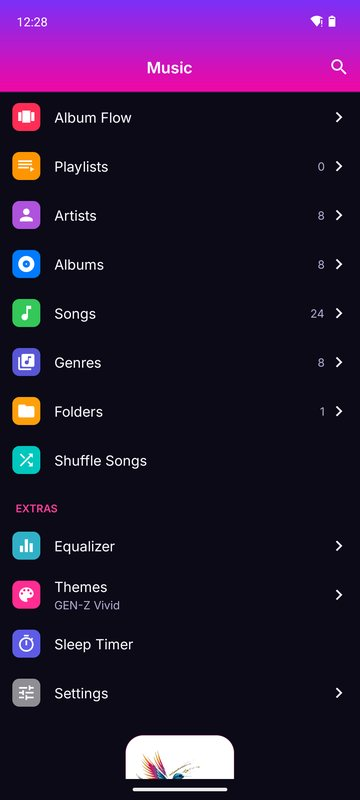 | 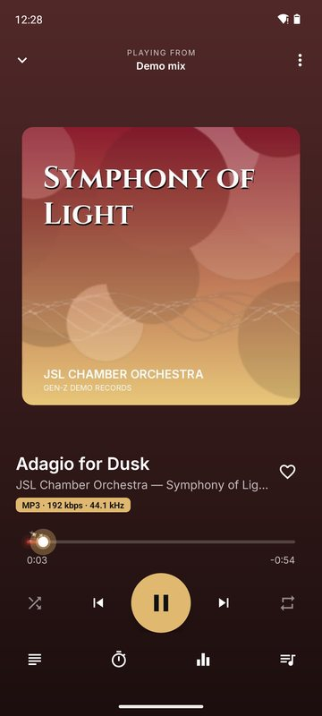 | 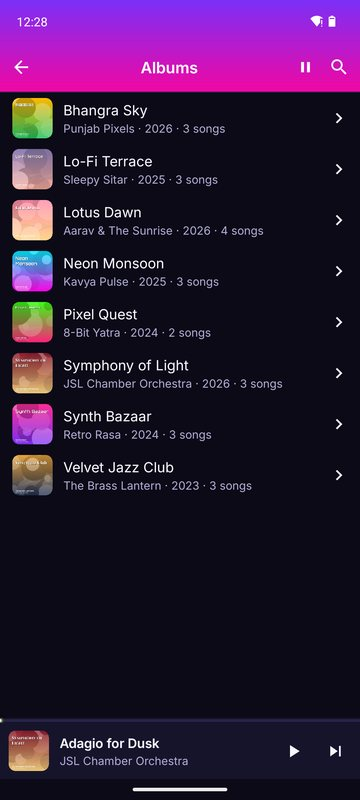 | 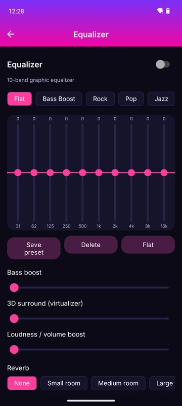 |
| **Themes** | **Theme editor** | **Love it!** | **Lock screen** |
| 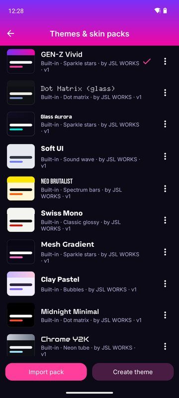 | 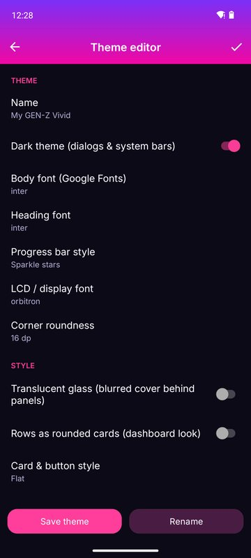 | 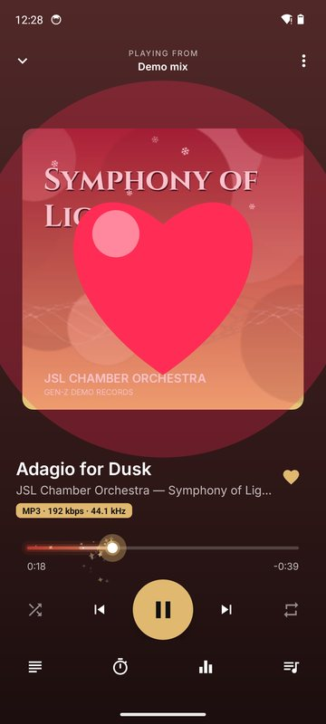 | 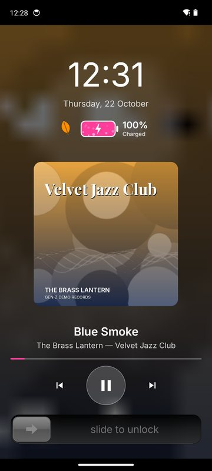 |
| **Bollywood Nights** | **Synthwave '84** | **Retro Clickwheel** | **Cassette '84** |
| 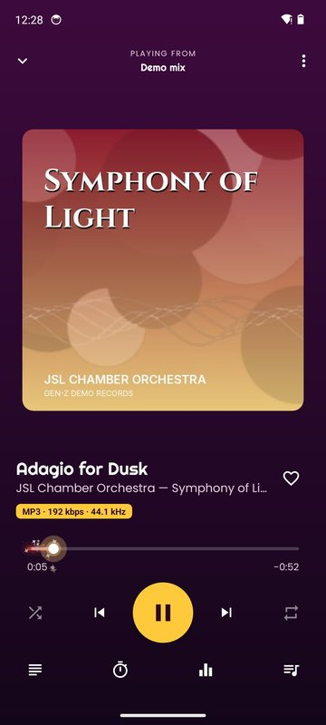 | 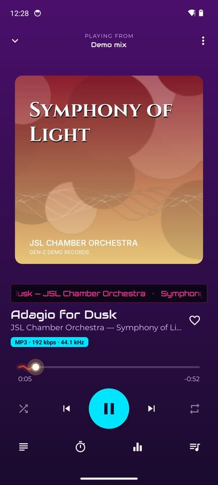 | 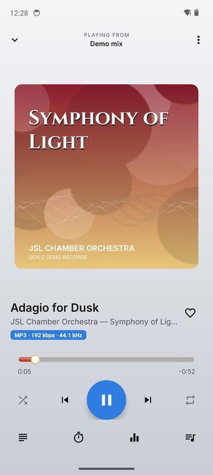 | 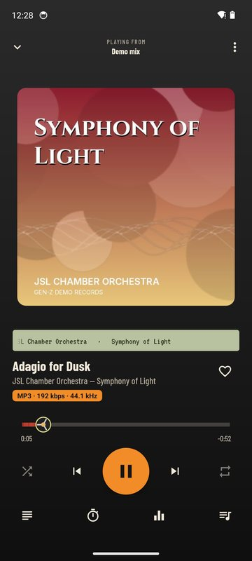 |

<sub>Screenshots use original demo songs and covers made for the user guide.</sub>

## Download

Every push to `main` is built automatically. The latest debug APK and the release bundle are on the
[`ci-output`](../../tree/ci-output) branch.

## Build it yourself

1. Install **Android Studio** (Ladybug or newer) with Android SDK 36.
2. Open this folder and let Gradle sync.
3. Press **Run**, or use *Build → Build APK(s)*.

Release bundle for Google Play: `./gradlew bundleRelease`, signed with your upload key through the
`GENZ_KEYSTORE`, `GENZ_KEYSTORE_PASSWORD`, `GENZ_KEY_ALIAS` and `GENZ_KEY_PASSWORD` environment
variables (or the matching GitHub secrets).

> Don't accept Android Studio's offers to upgrade the AndroidX / Material libraries in
> `app/build.gradle.kts`. They are pinned to the last versions that still support Android 4.4.

## Project layout

```
app/src/main/java/com/jslw/genz/
  audio/     playback engines (system decoder + own PCM/DSD decoder), effects, formats, tags
  data/      music scanner, library, playlists and statistics, settings
  playback/  background playback service, lyrics, shake to skip, floating lyrics
  skin/      themes and skin packs, fonts, icon packs
  ui/        all screens; ui/views holds the custom views (progress bars, cover effects, sliders …)
  widget/    home-screen widgets
app/src/main/assets/skins/   built-in themes (JSON)
app/src/main/res/font/       bundled Google Fonts
```

## Licence

**All rights reserved.** This code is public so it can be viewed. It is not open source. See
[LICENSE](LICENSE). Third-party components keep their own licences (Apache 2.0, SIL OFL 1.1); see
`app/src/main/assets/licenses/`.

[](https://doi.org/10.5281/zenodo.23637904)
  
